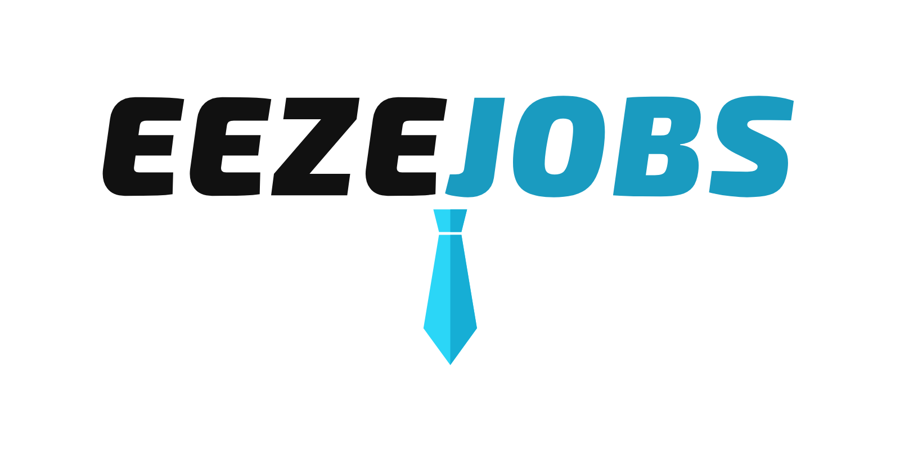

<p align="center"></p>

# eezejobs

**Type in your job and find out how much of it AI can already do, and what you can do about it.**

It's free. You don't sign up. Nothing you type gets saved.

> This is a student project made for learning. It is not money advice or career advice.

---

## What is this?

Everyone's talking about AI taking jobs. Some people say it'll take everything, some say it's all hype. I got tired of guessing, so I built a website that looks at the real numbers for **809 jobs in America** and tells you, in plain words:

- which parts of your job AI can already do
- which parts still need a real person
- which companies are making money from that AI
- which jobs near yours are safer
- what the stock market is betting will happen to your job

I made it simple enough for anyone. If you can type your job into a box, you can use this.

---

## How to use it

1. Open the website.
2. Type your job, like "nurse", "truck driver" or "accountant".
3. Read your report. That's it.

If you want more, click **Market's bet** at the top and put in your pay. It'll show you your own numbers.

---

## The big ideas, explained simply

### Your job is a list of chores

Every job is really just a bunch of tasks. A cashier scans items, counts money and helps customers. The US government keeps a list of the tasks for almost every job in the country. I went through each task and asked one question: *can AI do this yet?*

Some tasks AI can do on its own. Some it can help with. Some it can't touch. Your report sorts your tasks into those three piles.

### The AI score (0 to 100)

Think of it like a weather forecast for your job. A score of **83** means your job is more exposed to AI than 83 out of every 100 jobs. A high score doesn't mean you'll get fired tomorrow. It means AI can do or help with a lot of what you do, so your job is more likely to change.

### Where the score comes from

If you were really sick, you wouldn't trust just one doctor. You'd ask a few. I did the same thing. Each job gets judged by **10 different sources**:

- what people **actually use** AI chatbots for at work (from Anthropic and Microsoft)
- what **human experts** think AI can do
- what **university researchers** found
- and I asked **five different AIs** (GPT, Gemini, Claude, Llama and DeepSeek) to rate all 18,428 tasks with the exact same rules

Then I put all the answers together. If the sources disagree a lot about your job, the site tells you, so you know to take the score with a grain of salt.

### Safer jobs near yours

Some jobs use the same skills as yours but are less exposed to AI. A paralegal and a court clerk know a lot of the same stuff, for example. The site finds jobs like yours that pay about the same, don't need years of new school, and are safer. Think of them as next-door neighbors you could move to.

### Stocks, in one minute

A company is like a big pizza. A **stock** is one slice. If the company makes more money, everyone wants a slice, so each slice costs more. Companies that sell AI, like Microsoft or Google, make money when AI does more work.

### Hedging, or carrying an umbrella

Imagine you sell ice cream. When it rains, nobody buys ice cream and you lose money. But if you also own a little piece of an umbrella company, you make money on rainy days too. That's called a **hedge**: owning something that does well exactly when you're having a bad time.

So I asked: if AI is "rain" for your job, could owning the companies that sell AI be your "umbrella"? The site shows you how that would have worked since ChatGPT came out in 2022.

### The map on the home page

The home page is a 3D map of American work.

- Every **hill** is a crowd of workers. Bigger hill, more people doing that kind of job.
- Further **right** means more exposed to AI.
- Further **back** means better paid.
- The **water** is the "AI tide". It rises over the most exposed jobs to show how much work the stock market expects AI to take. You can switch it between today, 5 years and 10 years.

You can point at any dot to see the job and click it to open the report.

---

## Part 2: What Wall Street is betting will happen to your job

This is the part I'm proudest of.

### A lemonade stand

Say someone pays $1,000 for your lemonade stand. That tells you something. They must think the stand will sell a lot of lemonade in the future, or they wouldn't pay that much. If you know the price, you can work backwards and figure out roughly **how much lemonade they expect it to sell**.

The stock market works the same way. When people pay trillions of dollars for AI companies, they're betting those companies will make a ton of money. I worked backwards from those prices to figure out **how much money the market expects AI to make**.

### Where does that money come from?

If AI companies are expected to make hundreds of billions of extra dollars, that money has to come from somewhere. Mostly it comes from doing work that people get paid for today. So I matched the money to the jobs it would replace. Out comes the **stock market's own guess for every job**.

### Your chance of being automated

Car insurance is cheap for careful drivers and expensive for risky ones. The price tells you how risky something is. The same math lets me turn the market's bet into a **yearly chance** that a job like yours gets automated, and a **fair price for insurance** on your paycheck.

### 100,000 versions of your life

Nobody knows the future, so the site doesn't pretend to. Instead it plays out your career **100,000 times**, like rolling dice over and over. In some versions AI never touches your job. In others it does, and you take a pay cut. Then it shows you all the outcomes on one chart: the middle one, and the bad one in 20. This runs right inside your browser, in about a tenth of a second.

### What it all says

- The stock market is betting that **AI will do about 7% of all the pay in America within 5 years**. That's roughly $680 billion a year. Over 10 years it goes up to about 27%.
- The market moved its money **to the big AI companies** (like Google and Palantir) and **away from smaller software companies** that sell AI for one kind of job.
- But here's the twist. When I checked **real job numbers** from 2022 to 2025, AI hasn't caused any clear job losses yet. The market expects about 1.5% of pay to get automated every year. Real life shows almost nothing so far.

So either the market is early, or it's wrong. Nobody knows yet. That gap is the most interesting thing this project found.

---

## Other things I found

- **Better-paid jobs are more exposed to AI, not less.** AI is mostly coming for office work, not hands-on work.
- **About 41 million Americans** work in jobs where AI can do or help with a lot of the work.
- **The five AIs agree on which jobs are most exposed, but not on how much.** Gemini scored jobs about 22 out of 100 on average. GPT scored them about 52. So how scared you should be depends a lot on which AI you ask.
- **Buying the AI companies for your field mostly didn't work as an umbrella.** The companies selling AI to accountants and lawyers did worse than just buying the whole stock market. Only the giants (Microsoft, Google, Amazon, Meta, IBM, Nvidia) did better.
- **Virginia Tech grads are a little more exposed than the average US grad** (72.6 vs 70 out of 100). Computer Science, CMDA and Accounting are near the top.
- **Stock "trend" signals are basically a coin flip.** Stocks labeled "strong uptrend" beat the market only 47.5% of the time afterwards. The site shows that right next to every label, so nobody treats it like a tip.

---

## What this can't tell you

- A high score doesn't mean your job will disappear. A lot of jobs will just change.
- Your own job might be different from the average version of it.
- Nobody can predict the stock market. Every number here is a best guess with a range around it.
- I picked which companies count as "AI sellers" for each field. Someone else might pick differently.

---

## How I built it

I wanted every part done with the tool people in finance really use for that job. Think of it like a kitchen: you don't cut bread with a spoon. So the project uses more than a dozen programming languages, each one doing one clear job.

| Tool | What it does here, in plain words |
|---|---|
| **Python** | Downloads all the data and cleans it up |
| **SQL** | Keeps everything organized in one database |
| **R** | Does the statistics, to check if a pattern is real or just luck |
| **Java** | Tests the stock trend signals on past prices |
| **q / kdb+** | The super-fast database that trading firms use. Lines up stock prices with company reports by date, so nothing "cheats" by using information from the future |
| **Excel** | A spreadsheet you can download and play with |
| **OCaml** | Works the stock prices backwards (the lemonade stand math) |
| **APL** | Spreads the AI money across all 809 jobs |
| **Stan** | A careful way of checking what's *really* happening to jobs, with honest error bars |
| **Julia** | Plays out millions of possible careers super fast |
| **Haskell** | Writes and prices the "insurance for your paycheck" |
| **MATLAB / Octave** | Finds the best umbrella (hedge) for each job |
| **C++ (WebAssembly)** | Runs the heavy math right inside your browser |
| **Three.js + GLSL** | Draws the 3D map, the hills and the moving water |

To make sure the math was right, I wrote the stock signal test **three separate times** in three languages, and all three gave the exact same answer.

---

## For people who want the technical details

<details>
<summary>Where the data comes from</summary>

All of it is public and free:

- **O\*NET 31.0** (US Department of Labor): the tasks for each job, skills, training levels, related jobs
- **BLS wage data**, May 2022 and May 2025: how many people do each job and what it pays
- **Anthropic Economic Index**, **OpenAI "GPTs are GPTs"**, **Microsoft "Working with AI"**, **Felten, Raj and Seamans AIOE**: the AI exposure research
- My own 5-AI panel through OpenRouter (cost about $4)
- **NCES and IPEDS** (US Department of Education): which majors lead to which jobs, and how many students graduate in each
- **Indeed Hiring Lab**: job postings over time
- **Yahoo Finance**: stock prices
- **SEC EDGAR**: company financial reports
- **GDELT**: live news about your employer
</details>

<details>
<summary>How to run it yourself</summary>

The website:
```
python -m http.server 8000 --directory docs
```
Then open http://localhost:8000

Rebuild the data (Part 1):
```
pip install -r requirements.txt
python download_data.py
python build.py
python export_site.py
python src/excel_model.py
Rscript analysis/quant.R
Rscript analysis/stats.R
java java/src/eezejobs/Main.java
python src/kdb_signals.py          (needs a free KDB-X licence in .env)
```

Rebuild the market's bet (Part 2):
```
python download_data.py fundamentals 2022
python quant/run_q.py
python quant/pipeline.py ocaml apl stan gap
julia -t auto quant/julia/careers.jl
python quant/pipeline.py haskell octave export
```

The browser engine:
```
bash engine/build.sh
node engine/test.js
```
</details>

<details>
<summary>The finance and statistics terms, for the curious</summary>

- **Exposure score:** each source becomes a percentile, then they're averaged. The spread between sources is shown too.
- **Reverse DCF:** solving for the 10-year growth rate that makes a discounted cash flow model match each company's market value, compared with the day before ChatGPT launched.
- **Hazard curve:** the yearly chance of automation, read from the market's bet the same way credit traders read default odds from bond prices.
- **Monte Carlo:** simulating many random futures and looking at the spread of results.
- **Bayesian model:** estimates the real effect of AI on employment with honest uncertainty, sharing information across similar jobs.
- **Fama-MacBeth, Newey-West, clustered errors:** standard checks that a stock pattern isn't just luck.
- **Sharpe ratio:** return for each unit of risk. **Drawdown:** the biggest fall from a peak.
- **Quadratic programming:** the math for finding the mix of stocks that best cancels out a risk.

The closest academic work I know of: Borri, Liu and Tsyvinski, "AI Premium" (2026), which reads which jobs the market sees as exposed from stock movements; and Eisfeldt and others, "Generative AI and Firm Values" (2023). eezejobs adds a dollar estimate of automation for each job and checks it against real employment.
</details>

---

## License

MIT. Use it, share it, build on it.

Made by Arjun Ramaswamy, Virginia Tech. Part of the EEZE family.
